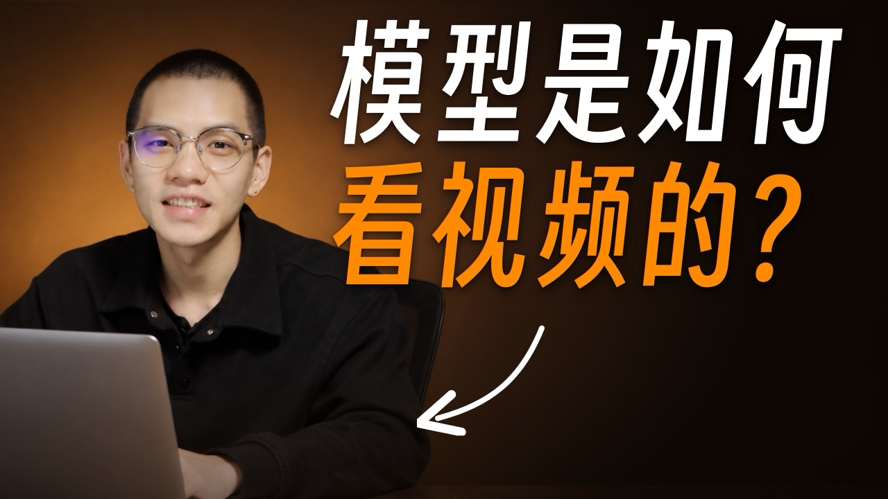

<!--
title: 模型如何看视频幕后：一条没有人脸的片，画面全是 AI 写代码画的
video: 模型是如何看视频的？你发的视频 AI 默认 1 秒只看一帧
author: 陈与小金（chenyuxiaojin）
author_url: https://xiaochens.com/
published: 2026-10-15
page: https://chenyuxiaojin.github.io/vibevideo/2026-10-11-model-watch-video/
-->

# 模型如何看视频幕后：一条没有人脸的片，画面全是 AI 写代码画的

视频《模型是如何看视频的？你发的视频 AI 默认 1 秒只看一帧》，6 分 58 秒，4:3，全片没有人脸。我录口播、剪气口、看片挑毛病、拍板；画面、配乐、音效、克隆音、字幕、导出，都是 AI 动的手。它自己写了一个 3D 渲染器，片子里那段红车夜街视频也是它用代码画的。

**[看网页版 →](https://chenyuxiaojin.github.io/vibevideo/2026-10-11-model-watch-video/)** 有每段的循环小片段、第一版和成片的同一时刻对照、成片时间线和两夜工作流的时间图。

## 片子讲的内容

一段 10 秒的 1080p 视频拖进对话框，模型拿到的是 300 张画面、1.86 GB 的像素。每个像素都当 Token 的话，一次注意力要两两比对 3.87×10¹⁷ 次，显存当场崩溃。所以要走四道工序：

1. **抽帧**：常见的默认做法是每秒只留 1 帧，300 帧丢 290 帧（96.7%）。
2. **切块**：每帧切成 16×16 像素的小块，一块 768 个数，压成一个 Visual Token。
3. **坐标**：给每个 Token 打上行列和秒数；声音变成时频谱图、切成 Audio Token，像拉链一样插进去。
4. **注意力**：最后输出一行字「一辆红色汽车向右行驶」。

## 谁做了什么

| | 做了什么 | 多少 |
|---|---|---|
| 我 | 录口播、在达芬奇里剪气口、看片说要不要、说哪里不对、拍板、写抖音标题简介、点发布 | 114 条消息 |
| Claude Code（主对话） | 导音频、克隆音、混音、补误删、开工作流派活、合并、渲染、自己看片、导出、发抖音 | 1,588 次操作 |
| 子 agent | 85 个（12 个工作流里 82 个，单独派 3 个）：做方向、画段落、当评委、做配乐音效、质检 | 7,314 次操作 |
| claude -p | 15 个独立沙盒、23 次调用：开头前三轮、现实锚点三档、第五轮 4 处、接缝排查 | 890 次操作，约 $88.77 |

AI 合计动手 9,792 次，其中打开自己渲出来的图检查 2,620 次。主对话 1,588 次：跑命令 1,158、读文件 216、操作达芬奇 88、操作浏览器 54、派活和收活 31、写和改文件 12、其他 29。

统计范围：10-11 18:21 到 10-15 15:26 做这条片的 6 段对话，加上它们派出去的 85 个子 agent 和 15 个 claude -p。不含 10-11 晚对稿子做受众模拟和事实核查的 13 个子 agent、做封面和标题的那段对话、发布后的对话，以及做这个幕后页的对话。10-11 那段主对话用的是 Fable 5.1，其余主对话、全部子 agent 和 claude -p 都是 Opus 5.5。

## 五天

- **10-11**：我用大疆麦录了一条 13 分钟的原始口播。英文词先念成「单词」占位、读错的短句没重录，AI 用我的声音零样本克隆补了 18 处。人声套我定的 B6 混音链。
- **10-12**：我在达芬奇里剪气口，8:01 剪到 6:45。AI 把剪前剪后逐段比对，找出 14 处误删（最长一整句 9.7 秒），补回染成橙色。开头 39 秒派 4 个 claude -p 各做一版，我说「都不太行」。
- **10-13**：参考其他博主的动效再做 2 版 + 融合 1 版，还是不行。18:10 我说重做；Claude Code 开工作流，5 个方向同时做、3 个评委打分，跑到第二天上午。
- **10-14**：10:54 开头我一看就认可。11 个 agent 58 分钟把后面 10 段和全片配乐一起做出来，再一轮 11 个修。晚上我说缺「现实锚点」，三档 claude -p 出方向，挑中那版又续跑 4 轮，显存崩溃变成一张真显卡。
- **10-15**：01:34 我睡前发一条消息，AI 派 18 个 agent 质检修改到 04:51。上午克隆音贴原声、修字体、对齐字幕字号、补一句漏掉的字幕。Remotion 直出 H.265，15:08 抖音发出，发布键我点。

## 七个阶段

### 01 声音：克隆音补词，剪完再查漏（10-11 – 10-12）

AI 用这段录音当参考，零样本克隆我的声音，只补英文词和读错短句所在的句子：18 处，合计约 2 分钟，我耳听全部通过。我剪完气口，AI 比对出我删了 68 处、52 秒，其中 14 处带字，最长一整句「然而，进入注意力层之前……排列不变性」9.7 秒。我确认误删，它全部补回、染成橙色，重出混音（-15.0 LUFS）和句子时间表。

### 02 开头 39 秒，前三轮都被否（10-12 – 10-13）

| 轮 | 版本 | 用时 | 花费 | 看图 | 结果 |
|---|---|---|---|---|---|
| 10-12 | medium（续跑改 3D） | 21.0 + 11.4 分 | $5.42 | 14 | 不行 |
| 10-12 | high | 27.4 分 | $4.38 | 15 | 不行 |
| 10-12 | xhigh | 45.5 分 | $10.86 | 29 | 不行 |
| 10-12 | high · 3D 版 | 26.2 分 | $7.15 | 21 | 都不太行 |
| 10-13 | high · 参考版 | 16.9 分 | $4.36 | 33 | — |
| 10-13 | xhigh · 参考版 | 37.7 分 | $9.87 | 33 | — |
| 10-13 | high · 两版融合 | 16.3 分 | $4.80 | 12 | 不行，重新做 |

7 个 claude -p 合计 $46.84。「看图」= 它打开自己渲出来的静帧和接触表检查的次数。

### 03 一夜：5 个方向同时做，评委打分，再修四路（10-13 夜）

5 个 agent 各做一个完全不同的方向：A 光的宇宙、B 冷酷的机器、C 小红车的 10 秒、D 时空晶体、E 一根光线。3 个评委 agent 打分，把 E 排第一、A 第二；Claude Code 自己再看两版静帧，选 A 当底版。两个 agent 在 A 上做两种「解开」的爆法，三个评委二选一；赢的那版拆成四路同时修，合并，两个质检 agent 只查不改，最后打磨。配乐同时在做：调用 Lyria 48 次，成功 43 条，剪出三段拼起来。

三个工作流 23 个 agent，3,798 次操作，打开自己渲的图 1,328 次；评委给终版震撼 8、好懂 8、做工 7.5。第二天 10:54 我看完：「我完全认可，太厉害了。」

### 04 后面 10 段：11 个 agent 一起开工（10-14 上午）

剩下 6 分多钟按句子之间的停顿切成 10 段，每两段在交接处画同一张「接力画面」，逐像素一致。10 个 agent 各画一段、1 个做全片配乐，58 分钟交回；再一轮 10 个修、1 个铺音效，又是 58 分钟。下午我说「知识可视化不够」，它重做第 2、8 段，我看了说「还不如上一版」，退回。

### 05 现实锚点：6.22 亿这个数，得让人看见（10-14 晚）

我说画面缺「现实锚点」。三档 claude -p 各出一个方向，我挑了 high：拿观众认识的那段红车视频当尺子，Token 就是从它身上切下来的块，6.22 亿就是 300 帧铺满的一面墙。我提「穿出去是一张正在运作的显卡，然后显存爆炸」，它先和我对齐再续跑。半夜我列了几处看不懂的地方，它开 4 个 claude -p 各改一处（对话框、流水线、速率、语言模型），再派一个只查不改的排查全片接缝。8 个 claude -p，15 次调用，合计 $41.93。排查结论：10 个段界逐像素无缝，割裂全在后来盖上去的地方，配乐也没跟着画面改。

### 06 睡前一条消息，AI 质检到天亮（10-15 凌晨）

01:34 我发了一条：对整条片做质检和优化，限时 6 小时。Claude Code 渲出整片 r0，请 Gemini 3.1 Pro 当普通观众和混音师各看一遍、逐段打分；再派 agent 分头查画面、评人声、修 QKV 那段、重做配乐音效；改完再渲 r1、r2、r3，最后 3 个 agent 分三截复查画面、1 个复查声音。04:51 收工。5 个工作流 18 个 agent，962 次操作，8 份 Gemini 整片评审。质检抓到的必修：结尾那句「一辆红色汽车向右行驶」往下掉，和字幕叠成一团。

### 07 收尾：克隆音、字幕、导出、发布（10-15 白天）

我听出克隆音「有点发蒙」：AI 把克隆段和旁边原声对比，变调、补 EQ、响度对齐、垫房间底噪，原声一个采样没动。我说字体不对：它查出画面刻字没等普惠体加载完就画了，修好；字幕字号对照我以前的成片改成字高 = 画高 5%。我发现「258 个 Visual Token」那句没上字幕，补上。Remotion 直出 H.265 2880×2160，399 MB，-14.8 LUFS。AI 用系统文件对话框塞进视频和横封面，标题、简介、话题、竖封面我自己改，发布键我点。

画面代码约 15,850 行（其中着色器 1,811 行）；三层 AI 合计跑 Remotion 渲视频 379 次、渲静帧 177 次（按命令条数，含低清预览）。

## 我说过的话（挑毛病的那几句）

- 10-12「这些都是误删，全部补回去，然后补回去之后，把这些片段全部进行染色。」→ 14 处补回、染橙。
- 10-12「都不太行，都不太行。」→ 开头第一轮 4 版全否。
- 10-13「我觉得不行，重新做吧。」→ 一夜开 5 个方向。
- 10-14「我完全认可，太厉害了。」→ 开头定稿。
- 10-14「我感觉还不如上一版呢……你恢复到上一版吧。」→ 退回。
- 10-14「我觉得现在画面是缺少一个锚点，让观众对里面的内容有一个现实锚点。」→ 拿红车视频当尺子。
- 10-14「直接从那里一下子穿梭到一张显卡的外面……然后显存爆炸。你先和我对齐啊，和我讨论，不要直接做。」→ 显卡显存崩溃。
- 10-15「虽然各个分段都没问题，但单独去细改某一段的时候，和上下经常融合得很差。」→ 只查不改的接缝排查。
- 10-15「我感觉克隆音的问题是，有点发蒙。」→ 克隆段贴原声。
- 10-15「这字体有点不对啊，你用的是黑体吗？」→ 修刻字字体、对齐字幕字号。

## 收获

1. **一版一版试不行，就让它一次开五个方向。** 前三轮 7 个 claude -p 都在一个思路里打转；一夜 5 个方向并排做、评委先筛，第二天早上我只看一版，一看就认可。
2. **每段都好，不等于接起来好。** 交接处画同一张图能保证段界无缝，但后来单独改、盖上去的地方还是会割裂，得专门派一个只查不改的去量。
3. **大数字要有一个看得见的东西去比。** 6.22 亿、3.87×10¹⁷ 念出来没感觉；拿观众认识的红车视频当尺子，再落到一张会炸的显卡上，才有重量。

## 花费

15 个 claude -p 合计约 $88.77（按 API 价格折算）：开头前三轮 $46.84，现实锚点和第五轮 $39.04，接缝排查 $2.89。续跑记录的是累计数，取最后一次。85 个子 agent 和 Claude Code 主对话的花费没有记录，算不出来。

---

[← 全部幕后](https://chenyuxiaojin.github.io/vibevideo/) · **陈与小金**（chenyuxiaojin）· 非程序员，用 Claude Code 做一切 · [个人网站](https://xiaochens.com/) · [博客](https://blog.xiaochens.com/) · [GitHub](https://github.com/chenyuxiaojin) · [YouTube](https://www.youtube.com/@cyxj_ai) · [B 站](https://space.bilibili.com/505358756) · [抖音](https://v.douyin.com/A1qVQrOgPjY/) · [X](https://x.com/cyxjya)
